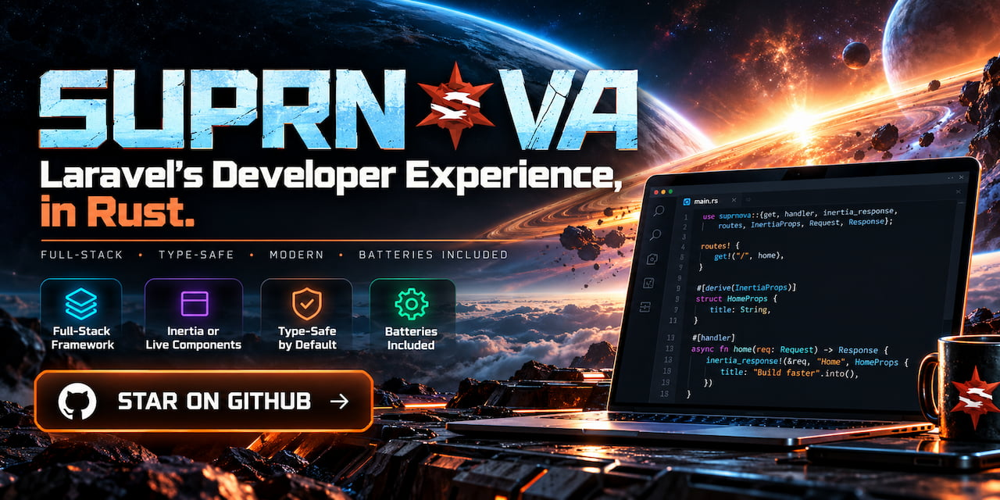
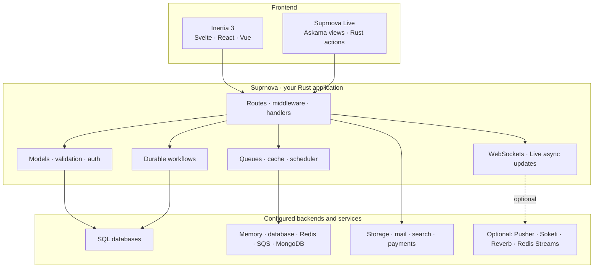

<p align="center">
  
</p>

<p align="center">
  <a href="https://github.com/eas4ai/suprnova/tags"></a>
  
  <a href="https://opensource.org/licenses/MIT"></a>
</p>

<p align="center">
  <a href="https://suprnova.app">Website</a> ·
  <a href="./manual/quickstart.md">Quickstart</a> ·
  <a href="./manual/README.md">Documentation</a> ·
  <a href="./manual/starter-kits.md">Starter kits</a> ·
  <a href="./CHANGELOG.md">Changelog</a>
</p>

Suprnova is a full-stack web framework for Rust. Its API reads like Laravel:
`Auth::login`, `Cache::remember`, Eloquent-style models, form requests,
`routes!`. Underneath it runs on Tokio, hyper and SeaORM, and the compiler
checks your models, routes and page props before anything ships.

## Why Suprnova

- **Familiar from day one.** If you know Laravel, you know where things are.
  The [From Laravel](./manual/from-laravel.md) guide maps each concept.
- **Checked at compile time.** Models, routes, form requests and page props
  are typed. A missing page component fails the build, and your TypeScript
  types are generated from the Rust structs.
- **One binary for every role.** Your app builds to one binary. It serves
  requests and holds WebSocket connections, and the same binary runs the
  queue worker, the scheduler and the workflow worker.
- **Two ways to build the front end.** An Inertia 3 app with Svelte 5,
  React 19 or Vue 3.5, or Suprnova Live: interactive, server-rendered
  components with no frontend framework.
- **Batteries included, never locked in.** Auth, queues, mail, storage,
  search and payments ship in the box. Every subsystem with more than one
  plausible backend is a trait with drivers you choose by configuration.

## Get started

Current `main` and the tagged v4.3.0 release both need Rust 1.94.0 or
newer. An Inertia front end also needs Node.js 20 or newer.

```bash
cargo install --git https://github.com/eas4ai/suprnova.git --tag v4.3.0 suprnova-cli
suprnova new myapp --frontend svelte
cd myapp
suprnova serve
```

`suprnova serve` starts your app at `http://localhost:8765`, runs the Vite
dev server beside it, and rebuilds when your Rust changes. Choose the front
end with `--frontend svelte`, `react` or `vue`, or `--frontend live` for the
Live kit, which needs no Node.js. The
[Quickstart](./manual/quickstart.md) builds a small app end to end.

## A first look

A model, its routes and three handlers:

```rust
use std::time::Duration;

use suprnova::{
    attrs, get, handler, inertia_response, json_response, model, post, request, routes, Cache,
    Collection, InertiaProps, Model, Redirect, Request, Response, RouteParam,
};

#[model(table = "posts", fillable = ["title", "body"])]
pub struct Post {
    pub id: i64,
    pub title: String,
    pub body: String,
    pub views: i64,
}

routes! {
    get!("/", home),
    get!("/posts/{post}", show),
    post!("/posts", store),
}

#[derive(InertiaProps)]
pub struct HomeProps {
    pub posts: Collection<Post>,
}

#[handler]
pub async fn home(req: Request) -> Response {
    let posts = Cache::remember("posts.popular", Some(Duration::from_secs(60)), || async {
        Post::query().filter_op("views", ">", 1000).get().await
    })
    .await?;
    inertia_response!(&req, "Home", HomeProps { posts })
}

#[handler]
pub async fn show(RouteParam(post): RouteParam<Post>) -> Response {
    json_response!({ "post": post })
}

#[request]
pub struct StorePostRequest {
    #[validate(length(min = 1, max = 200))]
    pub title: String,
    pub body: String,
}

#[handler]
pub async fn store(form: StorePostRequest) -> Response {
    let post = Post::create(attrs! { title: form.title, body: form.body }).await?;
    Redirect::to(format!("/posts/{}", post.id)).into()
}
```

- `#[model]` generates the SeaORM entity and the Eloquent-style API on the
  struct itself.
- `RouteParam<Post>` loads the post named in the URL, with its global
  scopes, and answers 404 when there is none.
- `#[request]` validates the body before the handler runs.
- `inertia_response!` checks at compile time that the `Home` page component
  exists, and `suprnova generate-types` gives the page a TypeScript type for
  `HomeProps`.

## Highlights

### Suprnova Live

Interactive pages without a frontend framework. A component is a Rust struct
with `#[derive(LiveComponent)]`, an Askama view and `#[action]` methods the
browser calls. State travels in a signed snapshot, and uploads and async
updates (over SSE or WebSockets, with a polling fallback) are built in. The
library has 59 components, from forms and overlays to data display, and
`suprnova live:add <name>` copies one into your app so you own its view,
styles and script. `suprnova live:check` checks your views' markup,
accessibility and Live directives. [Read the Live chapter](./manual/live.md).

### Typed from Rust to TypeScript

Define page props once in Rust with `#[derive(InertiaProps)]`. `suprnova
generate-types` writes `frontend/src/types/inertia-props.ts`, and `suprnova
serve` keeps it current as you edit. Rename a field and the TypeScript
compiler points at every component that uses it.

### Authentication

`Auth::login`, named guards, remember-me, email verification, password
reset, two-factor with recovery codes and brute-force lockout, plus
passkeys, magic links and OAuth with Apple, Facebook, Google, TikTok and X.
Gates and `#[policy]` handle authorization.
[Read the authentication chapter](./manual/authentication.md).

### Search and recommendations

Make a model `Searchable` and call its `search` method, ranked by your
database's own full-text search or by Qdrant, with filters, facets,
highlights and hybrid search over local or HTTP embeddings. Vector drivers
cover Qdrant, MariaDB, pgvector and Pinecone. `Recommend` ranks content from
your own events, with a knowledge-graph engine for richer suggestions.
[Search](./manual/search.md) · [Recommendations](./manual/recommendations.md)

### Durable workflows

Workflow steps record their results, so a workflow resumes where it stopped
after a restart and retries a failed step:

```rust
use suprnova::{start_workflow, workflow, workflow_step, FrameworkError, WorkflowHandle};

#[workflow_step]
async fn fetch_user(user_id: i64) -> Result<String, FrameworkError> {
    Ok(format!("user-{user_id}"))
}

#[workflow_step]
async fn send_welcome_email(user: String) -> Result<(), FrameworkError> {
    let _ = user;
    Ok(())
}

#[workflow]
async fn welcome_flow(user_id: i64) -> Result<(), FrameworkError> {
    let user = fetch_user(user_id).await?;
    send_welcome_email(user).await?;
    Ok(())
}

pub async fn on_signup(user_id: i64) -> Result<WorkflowHandle, FrameworkError> {
    start_workflow!(welcome_flow, user_id).await
}
```

Run the worker with `suprnova workflow:work`. It runs on Postgres.
[Read the workflows chapter](./manual/workflows.md).

## How it fits together



## What's in the box

Every subsystem with more than one plausible backend is a trait with
drivers, chosen by configuration. A new backend is a new driver, not a fork.

### Web

- **[HTTP and routing](./manual/routing.md):** `Router`, `routes!`, `group!`, named routes, resource controllers, route model binding with `RouteParam`, signed URLs (`sign_route`, `verify_signature`), `Redirect`, file and download responses (`HttpResponse::download`), `#[handler]`, `#[authorize]`.
- **[Middleware](./manual/middleware.md):** `CsrfMiddleware`, `CorsMiddleware`, `SessionMiddleware`, `TimeoutMiddleware`, `RequestIdMiddleware`, `ThrottleRequestsMiddleware`, `AuthMiddleware`, `GuestMiddleware`, `EnsureEmailVerifiedMiddleware`, `MaintenanceMiddleware`, `LocaleMiddleware`, `SecurityHeaders`, and your own global, group or per-route middleware.
- **[Inertia 3](./manual/frontend.md):** `#[derive(InertiaProps)]` with TypeScript generation, partial reloads, deferred and once props, merge strategies, SSR, and three starters: Svelte 5, React 19 and Vue 3.5.
- **[Validation](./manual/validation.md) and [data](./manual/data.md):** `#[request]` form requests, rules such as `Unique`, `Exists`, `Confirmed`, `RequiredIf` and `DateFormat`, `#[derive(Data)]` data objects, JSON:API resources.
- **[Response cache](./manual/render-cache.md):** `RenderCache` serves a GET or HEAD route you opt in from a stored copy of its response, without running the handler, when it can prove the copy is safe to share.

### Data

- **[Eloquent models](./manual/eloquent.md):** `#[model]`, relations from `HasMany` to `MorphedByMany`, eager loading, soft deletes, observers, global and local scopes, casts (`AsJson`, `AsNativeDateTime` and more), model events, factories and seeders, `Collection`, paginators, chunked and lazy iteration, joins.
- **[Database](./manual/database.md):** SQLite, Postgres, MySQL and MariaDB; SeaORM migrations with a Laravel-style `Schema` builder; `DB::transaction` with savepoints and `DB::after_commit`; read and write connections; `suprnova schema:dump`. [MongoDB](./manual/mongodb.md) through the `Mongo` facade, behind the `database-mongodb` feature.
- **[Cache](./manual/cache.md):** `Cache::remember`, `Cache::lock`, tags; `InMemoryCache`, `RedisCache` and `MongoCache` stores.
- **[Redis](./manual/redis.md):** `Redis::connection` with commands, pipelines, transactions and pub/sub.

### Background work

- **[Queues and jobs](./manual/queues.md):** `Queue`, `Job`, batches, chains, job middleware, failed-job store, unique jobs; `MemoryQueueDriver`, `SyncQueueDriver`, `DatabaseQueueDriver`, `RedisQueueDriver`, `SqsQueueDriver`, `MongoQueueDriver`, `NullQueueDriver` and `FailoverQueueDriver`.
- **[Events](./manual/events.md) and [bus](./manual/bus.md):** `EventFacade::dispatch`, `Listener`, `QueuedListener`, `Subscriber`, the command `Bus`.
- **[Scheduling](./manual/scheduling.md):** `Schedule::call`, `Schedule::command`, cron expressions, time zones, `suprnova schedule:work`.
- **[Workflows](./manual/workflows.md):** durable steps with `#[workflow_step]` and `#[workflow]` on Postgres, `suprnova workflow:work`.
- **[Processes](./manual/processes.md):** `Process::command` and `Process::shell` with timeouts, pools and pipes, and `Process::fake`.

### Real time

- **[Broadcasting](./manual/broadcasting.md) and [WebSockets](./manual/websockets.md):** public, private and presence channels; `BroadcastHub`, with `InMemoryBroadcastHub` inside your app, `PusherBroadcastHub` for Pusher, Soketi and Reverb, and `SeaStreamerBroadcastHub` for Redis Streams fan-out behind the `broadcasting-fanout` feature.
- **[Live async updates](./manual/live.md#asynchronous-updates):** server-pushed component updates over SSE or WebSockets, with a polling fallback.

### Auth

- **[Sign-in](./manual/authentication.md):** `Auth::login`, `Auth::user`, named guards, remember-me, [email verification](./manual/auth-flows.md#email-verification), [password reset](./manual/auth-flows.md#password-reset-and-lockout), two-factor with recovery codes, brute-force lockout.
- **[Sign-in methods](./manual/oauth.md):** passwords, [OAuth](./manual/oauth.md) (Apple, Facebook, Google, TikTok, X), [passkeys](./manual/authentication.md#passkeys) and magic links through `Auth::password`, `Auth::oauth`, `Auth::passkey` and `Auth::magic_link`.
- **[Authorization](./manual/authorization.md):** gates and `#[policy]`.

### Messages

- **[Mail](./manual/mail.md):** `Mail::to`, `Mailable`, queued mail; SMTP, Mailgun, Postmark, SendGrid, Resend and SES transports, plus log, file and in-memory ones for development.
- **[Notifications](./manual/notifications.md):** `Notify` with `MailChannel`, `DatabaseChannel`, `BroadcastChannel` and `WebPushChannel` ([web push](./manual/web-push.md)), anonymous notifiables.
- **[HTTP client](./manual/http-client.md):** `Http` with retries and `Http::fake`.

### Files and media

- **[Filesystem](./manual/filesystem.md):** `Storage` over OpenDAL: local, memory, S3 and S3-compatible stores (R2, B2, RustFS, MinIO), Azure and GCS behind features; a default disk from `FILESYSTEM_DISK`.
- **[Images](./manual/images.md):** `Image` transformations through the OxideAV or ImageMagick driver.

### Search and AI

- **[Search](./manual/search.md):** `Searchable` models with a `search` method, native database and Qdrant ranking, typed filters, facets, highlights, hybrid search with local or HTTP embeddings, analytics, JSON routes and a Live search box.
- **[Vector search](./manual/vector.md):** `Vector` with `MemoryVectorDriver`, `QdrantVectorDriver`, `MariaDbVectorDriver`, `PgVectorDriver` and `PineconeVectorDriver`.
- **[Recommendations](./manual/recommendations.md):** `Recommend` with immutable events, a scoped SQL starter engine, a graph engine on Memgraph (`RECOMMEND_ENGINE=graph`), explainable completed runs, search-event forwarding and provenance verification.

### Payments

- **[Billing](./manual/payments.md):** `Checkout`, `Subscription`, `CustomerStore` and `WebhookHandler` traits, with adapter crates for [Stripe](./manual/payments-stripe.md), [Paddle](./manual/payments-paddle.md) and [NOWPayments](./manual/payments-nowpayments.md).

### Developer tools

- **[Console](./manual/console.md):** your app's `console` binary, `#[command]` and `#[derive(Command)]`, `make:*` generators, `db:seed`.
- **[Logging](./manual/logging.md) and [observability](./manual/observability.md):** `Log` channels (`LOG_CHANNEL`: stdout, single, daily, syslog, stack and more), request IDs, `tracing` throughout, OpenTelemetry behind the `otel` feature, `Metrics`.
- **[Errors](./manual/errors.md):** in debug mode, a failing route shows the development error page in the browser; in tests, a failing response carries an `ErrorReport`.
- **[Localization](./manual/localization.md) and [strings](./manual/strings.md):** `Lang` with Fluent catalogs and locale-aware formatting, `Str::slug`, `Str::plural` and friends.
- **[Feature flags](./manual/feature-flags.md):** `Feature`, database-backed and cached evaluators.
- **[Heap profiling](./manual/deployment.md#heap-profiling):** the `heap-profiling` feature writes a dhat heap profile when the process ends, to the file `SUPRNOVA_HEAP_PROFILE` names.

### Testing

- **[Test tools](./manual/testing.md):** `#[suprnova_test]`, `TestDatabase`, in-process requests with `handle_request`, `expect!`.
- **[Fakes](./manual/mocking.md):** `Mail::fake`, `Queue::fake`, `EventFacade::fake`, `Notify::fake`, `Bus::fake`, `Storage::fake`, `Http::fake`, `Process::fake`.

[Laravel parity](./manual/parity.md) maps Laravel 13 feature by feature:
where Suprnova matches it, and where it differs on purpose.

## Starter kits and tools

- **[Nebula](https://github.com/eas4ai/Nebula)**: authentication on
  Inertia 3 and Svelte 5. Register, verify email, log in with remember-me,
  reset passwords and manage a profile.
- **[Pulsar](https://github.com/eas4ai/Pulsar)**: a product site and
  community on Vue 3.5 and Vuetify. Everything in Nebula, plus a landing
  page, dashboard, Markdown docs, a blog with RSS, member profiles, roles,
  and admin and moderation pages.
- **[Directory starter](https://github.com/eas4ai/suprnova-directory-starter)**:
  listings on Vue 3.5. Owners submit, moderators review, visitors search, and
  publication is free or paid through Stripe and Paddle.
- **[Suprnova LSP](https://github.com/eas4ai/suprnova-lsp)**: a language
  server for Suprnova apps, with hover and completion on the methods
  `#[model]` generates. Install the VS Code extension from its
  [releases](https://github.com/eas4ai/suprnova-lsp/releases).

## Documentation

- **[Quickstart](./manual/quickstart.md)**: a small app, end to end.
- **[Manual](./manual/README.md)**: every subsystem, also at
  [suprnova.app](https://suprnova.app). Start from
  [From Laravel](./manual/from-laravel.md) or
  [From Rust Web](./manual/from-rust-web.md) (Axum, Actix or Rocket).
- **[Introduction](./manual/introduction.md)**: the design principles.
- **[Changelog](./CHANGELOG.md)**: what changed in each version.

## Releases

Suprnova is distributed through git tags, not crates.io. The tag is the
release: an app depends on
`suprnova = { git = "https://github.com/eas4ai/suprnova.git", tag = "v4.3.0" }`
and moves versions by editing that one line. The adapter crates
(`suprnova-payments-stripe`, `suprnova-payments-paddle`,
`suprnova-payments-nowpayments` and `suprnova-web-push`) follow the same
model.

## Contributing

Read the [contribution guide](./manual/contributions.md) first. The rule is
full implementations only: well tested and production-ready.

## License

MIT, © 2026 Shawn McAllister and Dayem Siddiqui. See [LICENSE](./LICENSE).
Suprnova began as a fork of [Kit](https://github.com/dayemsiddiqui/kit)
(MIT, © Dayem Siddiqui) and has since gone its own way.
